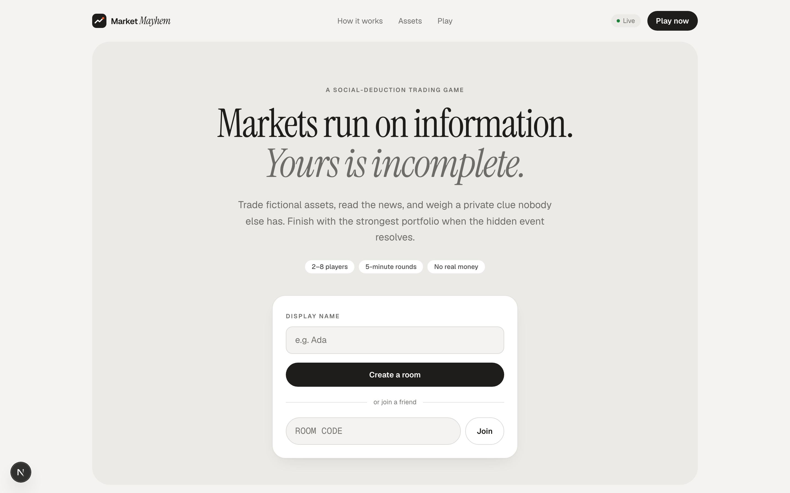
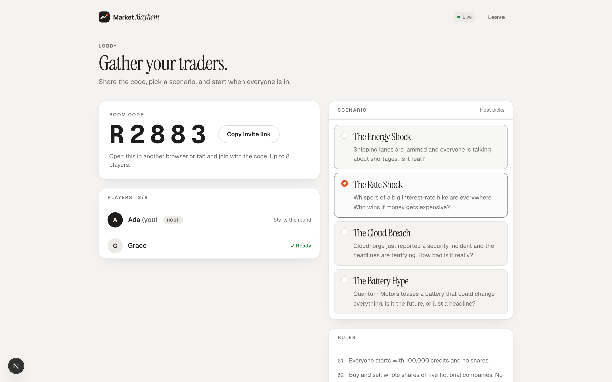
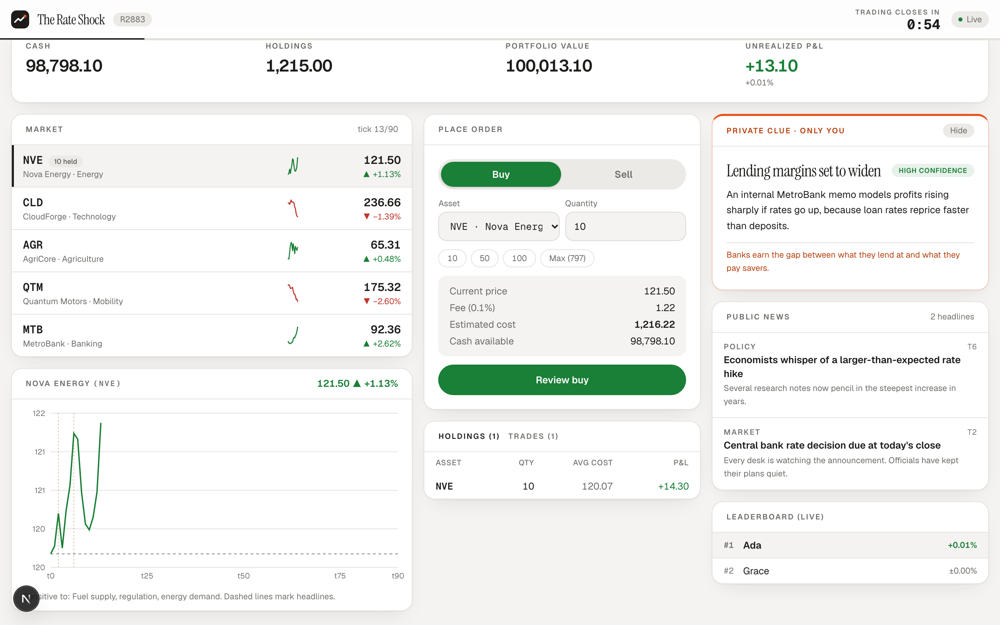
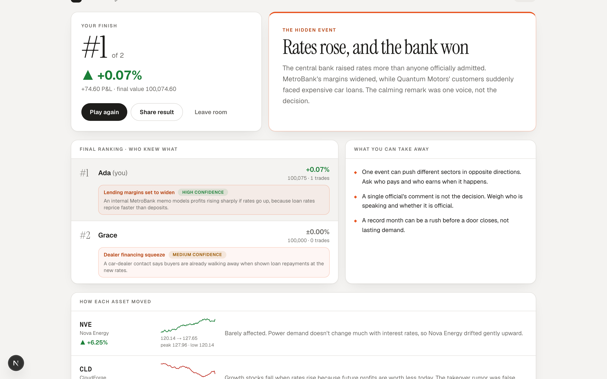
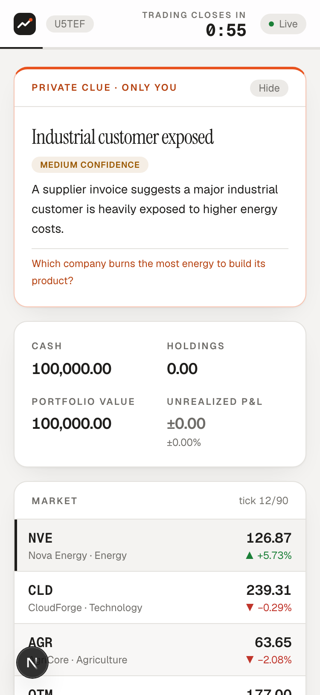

# Market Mayhem

A multiplayer market simulation where information is imperfect, trust is risky, and every decision has consequences.

Players trade five fictional assets with virtual credits, react to public headlines, and weigh a **private clue that nobody else has**. When the bell rings, a hidden event resolves, and the strongest portfolio wins. The results screen then explains what really happened.

> Fictional educational simulation. Virtual credits only. Not financial advice.

**Live demo:** _add your Vercel URL here_

## How to play

1. **Open a room.** Enter a name, create a room, and share the 5-letter code (or the invite link). Everyone starts with 100,000 virtual credits. The host picks one of four scenarios.
2. **Read the news, guard your clue.** Headlines reach everyone at once. You also get a private clue that nobody else sees, and it might be wrong: check its confidence level.
3. **Trade before the bell.** Buy and sell five fictional companies. When the timer ends, the hidden event resolves, final prices are applied, and the highest portfolio value wins. The results screen reveals every player's clue and explains what really happened.
4. **Or watch the news.** The **Live News** button opens MMN, a full-screen news channel with a speaking anchor. Some of its stories move prices a few ticks after they air, but you can't trade while you watch, and nothing is replayed.

| Landing | Lobby |
| --- | --- |
|  |  |
| **Trading** | **Results** |
|  |  |

On a phone, the private clue is pinned to the top of the trading screen:



### Scenarios

| Scenario | The question | What it teaches |
| --- | --- | --- |
| The Energy Shock | Shipping lanes are jammed. Is the shortage real? | A temporary shock and a lasting change look the same on day one. |
| The Rate Shock | A big rate hike is rumored. Who wins if money gets expensive? | One event can push different sectors in opposite directions. |
| The Cloud Breach | CloudForge reports a security incident. How bad is it? | Scary headlines move prices before the facts arrive. |
| The Battery Hype | A "battery breakthrough" is teased. Future, or headline? | Hype against fundamentals: buy the rumor, sell the news. |

Rules in full: [docs/game-rules.md](docs/game-rules.md).

## Quick start

```bash
pnpm install
pnpm dev          # Next.js on :3000 + game server on :4000
```

Open http://localhost:3000, create a room, then open the invite link in a **second browser window or tab** and join. Each tab is its own player, and a refresh keeps your seat.

| Script | What it does |
| --- | --- |
| `pnpm dev` | Web app and game server with hot reload |
| `pnpm demo:fast` | Same, with a ~70 s trading phase for quick demos |
| `pnpm test` | Engine, scenario-contract, balance, persistence and AI-summary tests, plus full multiplayer rounds over real sockets |
| `pnpm balance` | Plays every scenario with three fixed strategies and prints the balance table |
| `pnpm typecheck` / `pnpm lint` | TypeScript and ESLint |
| `pnpm build` and `pnpm start` | Production web build |
| `pnpm start:server` | Production game server |

To play from a phone on the same Wi-Fi, open `http://<your-LAN-IP>:3000`. The client connects to port 4000 on the same host automatically.

## What's in the demo

Everything in the blueprint's MVP scope:

- Guest identity with a server-issued player ID and a secret session token (stored in `sessionStorage`)
- Create and join rooms by 5-character code, ready-up, host start, and replay
- Five fictional assets with live prices, sparklines and a price chart. Headlines are marked on the chart.
- Buy and sell with a review/confirm step, fees and price impact, plus holdings and trade history
- Public news feed and a private clue card. Clues go only to the intended player.
- A server-authoritative timer and a state machine: `LOBBY → STARTING → ACTIVE → RESOLVING → FINISHED`
- Final ranking, every player's clue revealed ("who knew what"), a per-asset debrief and takeaways
- Reconnect: refreshing mid-round restores your room, portfolio and clue
- Seeded, reproducible market path (P1), with a fresh seed every round (`ROUND_SEED`)
- **Live Newsroom:** a full-screen TV studio with an animated anchor, browser text-to-speech, live captions, story illustrations and a price ticker. See below.

## Architecture

```
app/, components/, lib/   Next.js UI (client components), useGame socket hook
shared/                   Types, event names, Zod schemas, assets and rules shared by both sides
server/
  index.ts                Env config (Zod) and boot
  app.ts                  Express HTTP routes and Socket.IO handlers (validation, identity, rate limits)
  game/Room.ts            Room state machine, trading, ticking, scoring, results
  game/RoomManager.ts     Collision-checked room codes, idle-room cleanup
  engine/                 Pure functions: seeded RNG, price model, portfolio math, ranking
  scenarios/              Scenario configs (hidden truth) and balance hints. Server-only.
  balance/                Automated balance play-tests (`pnpm balance`)
  persistence/            Optional PostgreSQL (Prisma) write queue
  ai/                     Optional Gemini round summary (narrates computed results only)
  test/                   node:test suites
docs/game-rules.md        Player-facing rules and the price model
docs/scenario-authoring.md  The scenario contract and how to add one
docs/qa-matrix.md         Manual QA checklist for staging
docs/launch-checklist.md  Production release and demo-day checklist
pitch/                    Speaker notes and the demo script
```

**Server-authoritative.** The browser only sends intent (`symbol`, `side`, `quantity`, `requestId`, `roundId`). The server validates the payload with Zod, then checks membership, round state, deadline, cash and holdings. It sets the execution price and rejects duplicate request IDs. Cash, holdings, prices and scores never come from the client.

**Money** is stored as integer cents throughout, never floats.

### HTTP

| Route | Purpose |
| --- | --- |
| `GET /health` | Health check |
| `GET /api/assets` | Asset metadata and opening prices |
| `GET /api/rooms/:code` | Public room snapshot |
| `GET /api/rooms/:code/results` | Final results (409 until finished) |

Rooms are created and joined over Socket.IO (`room:create`, `room:join`), so creation is tied to the socket's guest identity.

### Socket.IO events

Client → server: `room:create`, `room:join`, `room:leave`, `player:ready`, `room:scenario` (host), `room:newsroom` (host, `{ enabled }`), `game:start` (host, optional `scenarioId`), `game:reset`, `trade:submit`, `game:requestState`

Server → client: `session`, `room:state`, `player:state` (private), `game:started`, `news:publish`, `newsroom:segment`, `clue:private` (private), `market:update`, `trade:result` (private), `game:finished`

Private events go to a per-player channel (`player:<id>`), never the room channel. Errors use structured codes such as `INSUFFICIENT_CASH`, `ROUND_CLOSED`, `INVALID_QUANTITY`, `NOT_IN_ROOM` and `DUPLICATE_REQUEST`.

## Environment

See `.env.example`.

| Variable | Use |
| --- | --- |
| `PORT` | Game server port (default 4000) |
| `CLIENT_ORIGIN` | Allowed frontend origin(s) for CORS and WebSockets, comma-separated. Required in production. |
| `NEXT_PUBLIC_SERVER_URL` | Game server URL used by the browser |
| `NODE_ENV` | development / production |
| `TICK_MS`, `STARTING_MS`, `RESOLVING_MS` | Round pacing |
| `DATABASE_URL` | Optional PostgreSQL URL (Supabase session pooler). Unset = in memory only. |
| `DATABASE_CA_CERT` | Optional PEM CA certificate for verified TLS to the database (Supabase's). |
| `DIRECT_URL` | Optional URL for migrations only, when `DATABASE_URL` is a transaction pooler. |
| `GEMINI_API_KEY` | Optional. Turns on the AI-written round summary. Game server only. |
| `GEMINI_MODEL` | Optional. Model for the summary (default `gemini-3.5-flash-lite`). |
| `GEMINI_RPM` / `GEMINI_TPM` / `GEMINI_RPD` | Optional. The key's quota (default 15 requests/min, 250,000 tokens/min, 500 requests/day). |
| `ROUND_SEED` | `random` (default): a new price seed every round. `scenario`: each scenario's fixed seed, for demos and replays (`pnpm demo:fast` uses it). |
| `NEWSROOM_SCRIPTS` | Live Newsroom anchor scripts: `none` (default, built-in templates) or `gemini` (needs `GEMINI_API_KEY`). |
| `NEWSROOM_MODEL` | Optional. Model for newsroom scripts, a Gemini or Gemma model id. Defaults to `GEMINI_MODEL`. |

## Live Newsroom

During a round, **Live News** opens MMN (Market Mayhem News), a full-screen studio drawn in SVG and CSS. An anchor reads general and market stories aloud with the browser's built-in speech (Web Speech API, no key needed). Captions are always on, and the anchor's mouth follows the words.

- **The engine decides every move.** Each scenario's `newsroom` plan says which stories air, when, and which prices they move ([docs/newsroom-plan-format.md](docs/newsroom-plan-format.md)). Effects become ordinary scenario events, so the same seed still gives the same market. The anchor's wording can't change any of it.
- **Watching costs trading time.** Stories show only on the newsroom screen, with no feed, toast or replay. Trading is closed while it is open, and some market stories air back to back.
- **No leaks.** `newsroom:segment` reaches the room only when a story airs, and it carries the headline, the caption lines and timing, never the story's kind or effects. Late joiners get only the story on air. After the bell, the results show a **broadcast log**: every story, what kind it really was, and what it moved.
- **Works with any scenario, and with no AI.** Every plan, hand-written or generated, is checked by `validateNewsroomPlan`. A missing or broken plan is replaced by one built from the scenario's news. Scripts come from templates by default. With `NEWSROOM_SCRIPTS=gemini`, a model rewords each story once per scenario in the lobby (cached, shared quota with the summary). Any line that adds a number, or a failed call, falls back to the template, so a round never waits for a model. Render's free tier can't run a local model such as Ollama, so use the hosted API or templates in production.
- The host can turn it off in the lobby. With it off, no stories air and their price moves don't happen.

## AI round summary (optional)

With `GEMINI_API_KEY` set on the game server, the results screen shows a short "AI-written summary" a few seconds after a round ends. Results never wait for it. It is built to use as few tokens as possible:

- **One call per round**, made when the round finishes, with no retries.
- **A compact prompt:** about 60 tokens of instruction plus about 250 tokens of facts for a 4-player round (short labelled lines instead of JSON, which measured 923 tokens). Only the fields the recap needs are sent: the outcome, each company's % move, the ranking with each player's clue, and the three largest trades.
- **Thinking off** (Gemini 2.x) or minimal (newer models), and the reply capped at about 70 words (`maxOutputTokens: 160`).
- A 20-second limit and no retries. Calls normally take 1 to 1.5 s, but occasionally spike to around 10 s on Google's side, and a retry would double the tokens. The results never wait for it. If the call fails, is blocked, runs long or invents a number, the summary is silently dropped.

- **Never over quota.** Every call first takes a slot from a limiter that stays 10% under the key's limits (13 requests/min, 225,000 tokens/min, 450 requests/day by default), over sliding windows. With no room, the call isn't made and the built-in debrief is shown. A 429 from the API pauses calls for a minute. After a restart, the daily count is rebuilt from rounds finished in the last 24 h (needs `DATABASE_URL`). The count is per server process, so a dev server using the same key isn't counted.

The server logs each call's token usage: `AI summary tokens: N in, M out`.

## Deploying

Two pieces: the Next.js web app on Vercel, and the game server on a host that keeps a Node process running with WebSockets (Render is set up here; Railway and Fly.io also work).

**1. Game server on Render**

1. Render → **New → Blueprint**, pick this repository. `render.yaml` creates the `market-mayhem-server` web service (build `pnpm install`, start `pnpm start:server`, health check `/health`).
2. Set `CLIENT_ORIGIN` to the web app URL from step 2 (comma-separate several, such as a preview and production URL). In production the server refuses to start without it, and it rejects WebSocket connections from any other origin.
3. Open `https://<service>.onrender.com/health`. It should return `{"ok":true,...}`.

**Optional: database on Supabase**

Without a database the server runs in memory, which is fine for a demo. With one, every round, trade and result is saved, and `GET /api/rooms/:code/results` still works after a room has left memory or the server has restarted.

1. Create a Supabase project. In **Connect**, copy the **Session pooler** connection string and fill in your database password. (The direct `db.<ref>.supabase.co` host is IPv6-only on the free plan, which Render can't reach.)
2. In **Database settings → SSL Configuration**, download the CA certificate.
3. Locally: put `DATABASE_URL` (and optionally `DATABASE_CA_CERT`) in `.env`, then run `pnpm db:migrate`. It creates the tables and enables row-level security so Supabase's public Data API can't read them. The game server connects as the table owner, which RLS doesn't restrict.
4. On Render: set `DATABASE_URL` and `DATABASE_CA_CERT`. The build runs `pnpm db:migrate` whenever `DATABASE_URL` is set.
5. Check: play a round, then open **Table Editor** in Supabase. `GameRoom`, `Trade` and `GameResult` should have rows.

If the database goes down, the game keeps running and only logs the failed writes. Writes are queued in the background and never awaited inside a round. Using Supabase's transaction pooler (port 6543) instead? Also set `DIRECT_URL` to the session pooler URL for migrations.

**2. Web app on Vercel**

1. Import the repository. Vercel detects Next.js and pnpm.
2. Set `NEXT_PUBLIC_SERVER_URL` to the Render URL (`https://<service>.onrender.com`). It is baked in at build time, so redeploy after changing it.
3. Go back to Render and make sure `CLIENT_ORIGIN` matches the Vercel URL exactly (scheme included, no trailing slash).

**Smoke test:** create a room on a laptop, join from a phone on mobile data, and play a full round.

**Demo-day notes**

- Render's free plan sleeps when idle, and the first request afterwards can take close to a minute. Open `/health` about 10 minutes before a demo.
- Fallback: `pnpm demo:fast` runs everything locally with a ~70 s trading phase.

## Known demo limits

- Rounds in progress live in memory, so a server restart ends them. Finished rounds, trades and results are saved when `DATABASE_URL` is set (see "Optional: database on Supabase").
- Four scenarios. Adding one takes a config file and one registry line; see [docs/scenario-authoring.md](docs/scenario-authoring.md). `pnpm test` checks it against the contract and the balance targets.
- The AI summary is optional and off without `GEMINI_API_KEY`. It only narrates results the engine already computed: every number in it must appear in the results, or it is discarded and the built-in debrief is shown alone. It is not saved to the database.
